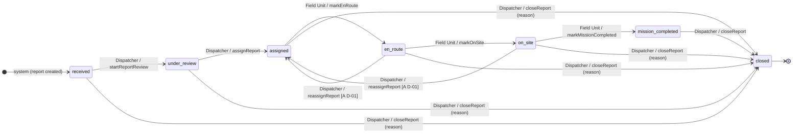
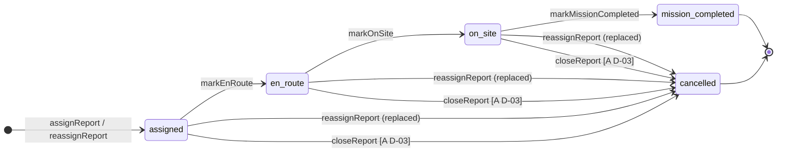
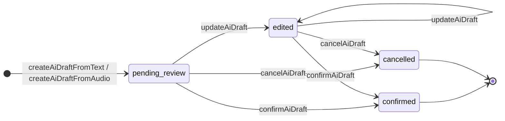

# State Transitions (v1.0)

Sources: SRS v1.1 section 7, ERD v1.1 enums `report_status` and `mission_status`, ERD explanation sections 6 and 10.
Labels: **[C]** confirmed by the sources, **[R]** design recommendation, **[A]** approved decision (D-01 to D-38 were approved on 2026-11-14; former **[A]** items are now approved defaults, see `API_DESIGN_DECISIONS.md`).

The platform has **two separate lifecycles**. They are updated together but are different data with different enums:

| | Report lifecycle | Mission (assignment) lifecycle |
|---|---|---|
| Stored in | `reports.current_status` (history in `report_timeline`) | `assignments.mission_status` |
| Enum | `received, under_review, assigned, en_route, on_site, mission_completed, closed` | `assigned, en_route, on_site, mission_completed, cancelled` |
| Scope | The whole incident | One unit's attempt; a report can have several (history) |
| `cancelled` | does not exist | exists and means *the assignment was replaced*, never that the report is cancelled |

There is no generic "set status" endpoint. Every transition is an explicit operation validated by the backend. Invalid transitions return **409** `invalid_state_transition`.

---

## 1. Report lifecycle



### 1.1 Transition table

| # | From | To | Role | Operation | Permission | Required input | Validation | Timeline / side effects | Notifications |
|---|---|---|---|---|---|---|---|---|---|
| 0 | (none) | `received` | system | `createManualReport`, `createSosReport`, `confirmAiDraft` | n/a (citizen action) | report data (SOS: severity set to `critical` automatically, D-11) | role Citizen; SOS: no `is_anonymous`; AI: draft explicitly confirmed | first `report_timeline` row, `changed_by = null` | none to the reporter; event `report.created` to operations |
| 1 | `received` | `under_review` | Dispatcher | `startReportReview` | pending `report.review` | none | current status is `received` (already `under_review` = 200 no-op) | timeline row, `changed_by` = dispatcher | reporter `status_update` |
| 2 | `under_review` | `assigned` | Dispatcher | `assignReport` | `report.assign` | `field_unit_id` | status `under_review`; no active assignment; unit exists | creates assignment (`assigned`); timeline row; audit `report.assign`; simulated-authority log | reporter and unit representatives `assignment` |
| 3 | `assigned` | `en_route` | Field Unit Representative | `markEnRoute` | pending `mission.update` | none | caller's unit owns the active assignment; mission status `assigned` | mission `en_route` + `en_route_at`; timeline row | reporter `status_update` |
| 4 | `en_route` | `on_site` | Field Unit Representative | `markOnSite` | pending `mission.update` | none | mission status `en_route` | mission `on_site` + `on_site_at`; timeline row | reporter `status_update` |
| 5 | `on_site` | `mission_completed` | Field Unit Representative | `markMissionCompleted` | pending `mission.update` | none (report attachment is separate, see D-04) | mission status `on_site` | mission `mission_completed` + `completed_at`; timeline row | reporter `status_update` |
| 6 | `mission_completed` | `closed` | Dispatcher | `closeReport` | `report.close` | `close_reason` (mandatory) | status `mission_completed`; reason not blank | `closed_by`, `closed_at`, `close_reason`; timeline row; audit `report.close` | reporter `closure` |
| 7 | `received`, `under_review`, `assigned`, `en_route`, `on_site` | `closed` | Dispatcher | `closeReport` | `report.close` | `close_reason` (mandatory) | status not already `closed`; reason not blank | as row 6; **[A D-03]** an active assignment is set to `cancelled` | reporter `closure` |
| 8 | `assigned`, `en_route`, `on_site` | `assigned` | Dispatcher | `reassignReport` | `report.assign` | `field_unit_id`, optional `note` | **[A D-01]** see section 2.2 | timeline row (note); audit | reporter, old unit, new unit |

[C] Rows 0-7 follow SRS section 7 literally. [C] "Field unit can only move 3 to 6" is implemented as the strict chain rows 3-5. **[A]** Row 8 is not in the SRS transition rules; it is required by the ERD reassignment workflow (D-01, D-02).

### 1.2 Rules

- [C] States advance in the documented order; steps cannot be skipped; the Field Unit Representative cannot close.
- [C] Dispatcher may close from any pre-closed state with a mandatory reason (false, duplicate, cancelled, ...). Closing an already closed report is 409.
- [C] `closed` is terminal. [R] A closed report accepts no edits, no new assignment, no new chat message (D-18, D-28).
- [C] Every transition writes `report_timeline` (who, when, note) and is audited where listed (NFR-010).
- [R] Concurrency: every transition runs in a transaction that locks the `reports` row (`SELECT ... FOR UPDATE`) and re-checks the current status. Two concurrent callers: one succeeds, the other receives 409.
- [R] Replays: a repeated identical transition returns 409, except `startReportReview` and `confirmAiDraft`/`cancelAiDraft` which are defined as idempotent.

### 1.3 Required request fields and errors

| Operation | Success | 404 | 409 `code` | 422 |
|---|---|---|---|---|
| `startReportReview` | 200 | unknown report | `invalid_state_transition` | n/a |
| `assignReport` | 201 | report or unit unknown | `invalid_state_transition`, `active_assignment_exists` | missing `field_unit_id` |
| `reassignReport` | 201 | report/unit unknown, no active assignment | `invalid_state_transition`, `same_unit`, `concurrent_assignment` | missing `field_unit_id` |
| `markEnRoute` / `markOnSite` / `markMissionCompleted` | 200 | assignment not owned by caller's unit | `invalid_state_transition`, `assignment_not_active` | n/a |
| `closeReport` | 200 | unknown report | `report_already_closed` | missing/blank `close_reason` |

---

## 2. Assignment / mission lifecycle



| From | To | Triggered by | Timestamp column |
|---|---|---|---|
| (new) | `assigned` | `assignReport`, `reassignReport` | `assigned_at` |
| `assigned` | `en_route` | Field Unit Representative | `en_route_at` |
| `en_route` | `on_site` | Field Unit Representative | `on_site_at` |
| `on_site` | `mission_completed` | Field Unit Representative | `completed_at` |
| `assigned`, `en_route`, `on_site` | `cancelled` | Dispatcher reassignment (or early closure, D-03) | `cancelled_at` |

`mission_completed` and `cancelled` are terminal for an assignment.

### 2.1 Active assignment constraint [C]

A report may have many assignments over time but **at most one non-cancelled one at any moment**. A report with a `mission_completed` assignment still has that one "active" (non-cancelled) assignment, so a new one cannot be created unless that report is reassigned **before** completion; reassignment after completion is 409 (D-01).

- `Assignment.is_active` in the API is derived: `mission_status != cancelled`.
- The database guard is the partial unique index on `assignments(report_id) WHERE mission_status <> 'cancelled'` (ERD explanation). DBML cannot express it, so it must be created in the physical schema (migration phase).
- [R] Application guard: lock the `reports` row, then check for an active assignment, then insert. The index is the safety net; a unique-violation is translated to 409 `concurrent_assignment`.

### 2.2 Reassignment workflow [C for the cancel/create mechanics, U for the allowed states]

```
Existing Assignment A (assigned | en_route | on_site)
  -> lock report row
  -> A.mission_status = cancelled, A.cancelled_at = now     (A kept as history, never deleted)
  -> create Assignment B (mission_status = assigned, assigned_at = now, assigned_by = dispatcher)
  -> reports.current_status = assigned                        [A D-01: regression from en_route/on_site]
  -> report_timeline row (status = assigned, note = reassignment note)
  -> audit_logs (report.assign, old = A, new = B)
  -> notifications: reporter, representatives of unit A (cancellation), representatives of unit B (new task)
  -> commit; then emit events and write the simulated authority log for B
Only B is active.
```

- Validation: report status in (`assigned`, `en_route`, `on_site`); new unit differs from A's unit; unit exists.
- If any step fails, **everything rolls back**: A stays active and untouched.
- History is read with `listReportAssignments`; the active one with `getActiveAssignment`.

### 2.3 Synchronisation of the two lifecycles [C]

On every mission update (`markEnRoute`, `markOnSite`, `markMissionCompleted`) one database transaction performs:

1. validate: assignment belongs to the caller's unit, is the active assignment, status is the expected predecessor;
2. update `assignments.mission_status` and the stage timestamp;
3. update `reports.current_status` to the same-named report state;
4. insert the `report_timeline` row (`changed_by` = the representative);
5. insert the reporter's `notifications` row.

After a successful commit only: broadcast `report.status_changed` and `assignment.status_changed`, and `notification.created`.

Failure behaviour:

| Failure | Result |
|---|---|
| validation (wrong state, not owner, not active) | 409 (or 404 when not visible); nothing written |
| database error in steps 2-5 | transaction rolled back; 500 `internal_error`; no partial state; no event |
| event broadcast fails after commit | request still succeeds (200); broadcast retried by the queue; clients can resync with the REST reads |

Correspondence table:

| Mission status | Resulting report status |
|---|---|
| `assigned` (new assignment) | `assigned` |
| `en_route` | `en_route` |
| `on_site` | `on_site` |
| `mission_completed` | `mission_completed` |
| `cancelled` | no direct mapping: the report moves to `assigned` (reassignment, D-01) or `closed` (early closure) |

---

## 3. AI extraction draft lifecycle (not a report lifecycle) [C]



- A draft is **not** a report. `reports` is written only by `confirmAiDraft`, which also sets `ai_extractions.report_id` and `confirmed_at` in the same transaction.
- `confirmAiDraft` is idempotent: a second call returns 200 and the same report, never a duplicate (row lock on the draft + one-to-one `report_id`).
- Edits and cancellation of a confirmed draft are 409; confirming a cancelled draft is 409.

## 4. SOS flow [C/R]

```
Citizen taps SOS -> client shows countdown (system_settings value, default 5 s)
   cancel pressed  -> nothing is sent (no report exists, nothing to cancel on the server)   [A D-09]
   countdown ends  -> POST /me/reports/sos  (Idempotency-Key)  -> report received, source=sos, type "SOS عام", is_anonymous=false, severity=critical (D-11)
```
