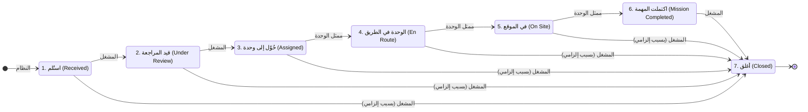

# وثيقة متطلبات البرمجيات (SRS)
## منصة «استجابة» للاستجابة للطوارئ والكوارث والبلاغات الأمنية

* **نوع المشروع:** نظام ويب موحد للإبلاغ عن الطوارئ
* **السنة الأكاديمية:** 2025-2026
* **الإصدار:** 1.1
* **حالة الوثيقة:** مسودة أولية قابلة للمراجعة والاعتماد

---

### سجل التعديلات (Revision History)

| الإصدار | التعديلات |
| :---: | :--- |
| **1.0** | النسخة الأولى من الوثيقة. |
| **1.1** | 1. إعادة بناء مخطط حالات الاستخدام وفق ملاحظات المشرف: حذف علاقات `include` التي تمثل خطوات تنفيذ داخلية، وإبقاء العلاقات الصحيحة فقط (4 علاقات `include` و 6 علاقات `extend`)، وإزالة Whisper والنموذج اللغوي من الـ Actors، وإضافة Actor مجرد باسم `Platform User`. 2. إزالة أسماء المنتجات والتقنيات (Whisper, MapLibre, Leaflet, PostgreSQL, PostGIS, WebSockets, JWT, REST) من المتطلبات وإبقاء الوصف مجرداً؛ تُحسم التقنيات في وثيقة التصميم. 3. إضافة المتطلبات `FR-034` إلى `FR-039` لتغطية حالات استخدام لم يكن لها متطلب: إدارة المستخدمين، سجل التدقيق، إعدادات النظام، كشف الهوية، إشعار المبلّغ، طبقة المحاكاة. 4. توحيد حالات البلاغ (القسم 7) وحل التعارض بين الحالات التي يراها المواطن والحالات التي تحدّثها الوحدة الميدانية. 5. توضيح `FR-009` و `FR-023` و `FR-027`، وفصل `NFR-008` عن `NFR-009`، وترقيم متطلبات القسم 6.5 إلى 6.8، وجعل `NFR-005` قابلاً للقياس. 6. توحيد التسمية: `Field Unit Representative` بدل `Field Unit`، و `Dispatcher` بدل `Operator / Dispatcher`. |

---

## 1. المقدمة (Introduction)

### 1.1 نطاق المشروع (Project Scope)
منصة «استجابة» هي منصة ويب موحدة تتيح للمواطنين الإبلاغ الفوري عن حالات الطوارئ والكوارث والبلاغات الأمنية، مثل الحرائق والحوادث المرورية والفيضانات والمخاطر الصحية والسرقات والأنشطة المشبوهة وحالات فقدان الأشخاص.

توفر المنصة واجهة للمواطنين لإرسال البلاغات ومتابعتها، بالإضافة إلى لوحة عمليات مركزية تتيح للمشغلين مراجعة البلاغات وتحديد أولوياتها وتوجيه الوحدات الميدانية المختصة ومتابعة تقدم الاستجابة.

تتضمن المنصة بوتاً ذكياً يعتمد على تقنيات الذكاء الاصطناعي لتحويل وصف المواطن للحادثة، سواء كان نصياً أو صوتياً، إلى بلاغ منظم قابل للمراجعة والتعديل قبل الإرسال.

**يشمل نطاق المشروع:**
* تطبيق أصلي (Native App) للهواتف الذكية للمواطنين.
* تطبيق أصلي (Native App) للهواتف الذكية للوحدات الميدانية.
* تطبيق ويب (Web App) خاص بمدير النظام وغرفة العمليات.
* بوت محادثي ذكي للإبلاغ النصي والصوتي.
* خرائط تفاعلية لعرض البلاغات والوحدات الميدانية.
* نظام إشعارات وتنبيهات داخل المنصة.
* طبقة محاكاة للتكامل مع الجهات المختصة (`FR-039`).

**ما لا يشمله نطاق المشروع:**
* الربط الفعلي مع أنظمة الشرطة أو الإسعاف أو الدفاع المدني الحكومية (انظر `FUT-005`).
* استقبال البلاغات عبر الرسائل القصيرة (SMS).
* إدارة صلاحيات متعددة المدن أو المناطق الإدارية بصورة موسعة.

---

## 2. الوصف العام للنظام (Overall Description)

### 2.1 منظور المنتج (Product Perspective)
تعمل منصة «استجابة» كنظام ويب مركزي يتكون من وحدات مترابطة:
1. **واجهة المواطن:** لإرسال البلاغات ومتابعتها واستقبال التنبيهات.
2. **غرفة العمليات:** لإدارة البلاغات ومراجعتها وتوجيهها.
3. **واجهة الوحدات الميدانية:** لاستلام المهام وتحديث حالتها.
4. **واجهة مدير النظام:** لإدارة المستخدمين والصلاحيات والإعدادات ومراقبة العمليات.
5. **خدمة الذكاء الاصطناعي:** لتحليل المحادثات واستخراج بيانات البلاغات.
6. **خدمة الخرائط:** لعرض المواقع والبلاغات والوحدات.
7. **خدمة الإشعارات:** لإرسال التحديثات والتنبيهات للمستخدمين.

تتواصل هذه الوحدات من خلال واجهة خلفية مركزية (Backend)، مع استخدام قاعدة بيانات موحدة لتخزين البيانات وإدارة العمليات.

### 2.2 أهداف النظام (Product Goals)
* توحيد قنوات الإبلاغ عن الحوادث والطوارئ.
* تقليل الوقت والجهد اللازمين لإرسال البلاغ.
* تحسين تنظيم البلاغات وتصنيفها.
* تسهيل متابعة البلاغات من قبل المواطنين.
* مساعدة غرفة العمليات في تحديد أولويات الاستجابة.
* تسهيل توجيه الوحدات الميدانية ومتابعة عملها.
* توفير آلية تنبيه للمستخدمين الموجودين ضمن منطقة خطر.
* الاستفادة من الذكاء الاصطناعي في تحويل وصف الحادثة إلى بيانات منظمة.

### 2.3 فئات المستخدمين (User Classes)

#### 2.3.1 المواطن (Citizen)
مستخدم يستطيع إنشاء حساب واستخدام المنصة لإرسال البلاغات ومتابعتها واستقبال التنبيهات المتعلقة بمنطقته.

#### 2.3.2 مشغل غرفة العمليات (Dispatcher)
مستخدم مسؤول عن مراجعة البلاغات والتحقق منها وتعديل بياناتها عند الحاجة، وتحديد أولوياتها وتوجيهها إلى الوحدات المختصة.

#### 2.3.3 ممثل الوحدة الميدانية (Field Unit Representative)
مستخدم تابع لوحدة ميدانية، مثل الشرطة أو الدفاع المدني أو الإسعاف، يستطيع الاطلاع على البلاغات المسندة إلى وحدته وتحديث حالة تنفيذ المهمة.

#### 2.3.4 مدير النظام (System Administrator)
مستخدم يمتلك صلاحيات إدارة النظام والمستخدمين والأدوار والإعدادات ومراقبة العمليات الإدارية، بما في ذلك صلاحية كشف هوية البلاغات المخفية للضرورة الأمنية.

#### 2.3.5 مستخدم المنصة (Platform User)
دور مجرد (Generalization) ترث منه الأدوار الأربعة السابقة الوظائف المشتركة، وهي تسجيل الدخول وتسجيل الخروج.

---

## 3. المتطلبات الوظيفية (Functional Requirements)

تم ترقيم المتطلبات الوظيفية باستخدام الرمز `FR`، بحيث يكون لكل متطلب رقم مستقل يمكن الرجوع إليه أثناء التطوير والاختبار.
*(ملاحظة: أضيفت المتطلبات `FR-034` إلى `FR-039` في الإصدار 1.1 لتغطية حالات استخدام لم يكن لها متطلب مقابل).*

### 3.1 إدارة الحسابات والمصادقة

* **`FR-001`: إنشاء حساب مستخدم**
  * **الوصف:** يجب أن يسمح النظام للمواطن بإنشاء حساب جديد من خلال إدخال البيانات المطلوبة في نموذج التسجيل.
  * **شروط القبول:** يستطيع المستخدم إدخال بيانات التسجيل، يتحقق النظام من صحة الحقول، يمنع الحسابات المكررة، وتظهر رسالة واضحة بالنجاح أو الفشل.

* **`FR-002`: تسجيل الدخول**
  * **الوصف:** يجب أن يسمح النظام للمستخدم المسجل، بأي دور، بالدخول إلى حسابه باستخدام بيانات المصادقة المعتمدة.
  * **شروط القبول:** التحقق من صحة البيانات، منع الدخول ببيانات خاطئة، وإنشاء جلسة مصادقة آمنة.

* **`FR-003`: تسجيل الخروج**
  * **الوصف:** يجب أن يسمح النظام للمستخدم بإنهاء جلسة الاستخدام الحالية بحيث لا يمكن الوصول إلى الصفحات المحمية بعدها.

* **`FR-004`: إدارة الأدوار والصلاحيات**
  * **الوصف:** يجب أن يطبق النظام آلية تحكم بالوصول تعتمد على دور المستخدم (RBAC). الأدوار الأساسية: `Citizen`, `Dispatcher`, `Field Unit Representative`, `System Administrator`.
  * **شروط القبول:** لا يمكن الوصول إلى وظائف خارج الصلاحية، يمكن للمدير إدارة الأدوار والصلاحيات، والتحقق يتم في الواجهة الخلفية.

### 3.2 واجهة المواطن (Citizen Module)

* **`FR-005`: عرض الصفحة الرئيسية**
  * **الوصف:** يجب أن تعرض واجهة المواطن الخدمات الأساسية: «طارئ الآن»، «بلاغ أمني»، «تنبيهات منطقتي» بوضوح ليتمكن المستخدم من الوصول إليها.
  * **شروط القبول:** تظهر الخدمات الثلاث بوضوح ويمكن الوصول إلى كل منها مباشرة من الصفحة الرئيسية.

* **`FR-006`: إرسال بلاغ طارئ عبر زر SOS**
  * **الوصف:** يجب أن يوفر النظام زر SOS لإرسال طلب مساعدة طارئ مع محاولة تحديد الموقع تلقائياً.
  * **شروط القبول:** يحاول النظام الحصول على الموقع، يعرض مهلة إلغاء 5 ثوانٍ، وإذا لم يُلغَ يتم الإرسال. إن تعذر تحديد الموقع يُبلَّغ المستخدم بذلك.

* **`FR-007`: إنشاء بلاغ يدوي**
  * **الوصف:** يجب أن يسمح النظام للمواطن بإنشاء بلاغ يدوياً بحقول تشمل: نوع البلاغ، وصف الحادثة، الموقع الجغرافي، إرفاق صور / فيديو، وتسجيل صوتي قصير.
  * **شروط القبول:** يُسجَّل البلاغ بحالة «استُلم» ويظهر في قائمة بلاغات المواطن.

* **`FR-008`: تصنيف أنواع البلاغات**
  * **الوصف:** يجب أن يدعم النظام تصنيفات محددة وترتبط بجهات مختصة.
  * **شروط القبول:** يختار المواطن تصنيفاً واحداً على الأقل، ويُقترح للبلاغ الجهة المرتبطة بتصنيفه وفق الجدول التالي:

| التصنيف الرئيسي | أمثلة على البلاغات | الجهة المقترحة |
| :--- | :--- | :--- |
| **الطوارئ المدنية** | حريق، تسرب غاز، انهيار، فيضان | الدفاع المدني |
| **الحوادث المرورية** | حادث مروري | المرور والإسعاف |
| **البلاغات الأمنية** | سرقة، نشاط مشبوه، تحرش، ابتزاز، مفقود | الشرطة |
| **المخاطر الصحية** | حالة صحية طارئة أو خطر صحي | الإسعاف / الصحة |

* **`FR-009`: إرسال بلاغ بهوية مخفية**
  * **الوصف:** يجب أن يسمح النظام للمواطن المسجل بإرسال بلاغ يدوي أو بلاغ عبر المساعد الذكي مع تفعيل خيار «إخفاء الهوية». في هذه الحالة، لا تظهر بيانات أو هوية المواطن لغرفة العمليات أو للوحدات الميدانية (يظهر كـ «مبلّغ مجهول»)، وتقتصر صلاحية كشف الهوية على «مدير النظام» فقط للضرورة الأمنية وتحري البلاغات الكاذبة (`FR-037`).
  * **شروط القبول:** لا تظهر بيانات الهوية في أي واجهة للمشغل أو الوحدة الميدانية، بما فيها الدردشة والتقارير. يبقى المواطن قادراً على تتبع بلاغه (`FR-010`) والتواصل عبر الدردشة (`FR-025`).

* **`FR-010`: تتبع حالة البلاغ**
  * **الوصف:** يجب أن يسمح النظام للمواطن بمتابعة حالة بلاغه وتفاصيله من خلال حسابه الشخصي في المنصة. الحالات: استُلم، قيد المراجعة، حُوّل إلى وحدة، الوحدة في الطريق، في الموقع، اكتملت المهمة، أُغلق (القسم 7).
  * **شروط القبول:** تظهر الحالة الحالية وتفاصيل البلاغ والمسار الزمني لتغير الحالات.

* **`FR-011`: استقبال إشعارات البلاغ**
  * **الوصف:** يجب إشعار المواطن عند حدوث تحديثات مهمة (تحديث حالة، تحويل لوحدة، إغلاق).
  * **شروط القبول:** يصل الإشعار إلى المواطن ويرتبط بالبلاغ المعني.

* **`FR-012`: عرض تنبيهات المنطقة**
  * **الوصف:** يجب عرض التنبيهات الموجهة للمنطقة الجغرافية للمستخدم شاملة الخطر ووصفه ووقته.
  * **شروط القبول:** تظهر للمستخدم التنبيهات الخاصة بمنطقته مرتبة من الأحدث.

### 3.3 بوت الإبلاغ الذكي (AI Conversational Reporting Bot)
*(ملاحظة: يُقصد بـ «مكوّن الذكاء الاصطناعي» في هذه الوثيقة أي نموذج أو خدمة قادرة على أداء الوظيفة المطلوبة، دون ربط الوثيقة بمنتج بعينه).*

* **`FR-013`: استقبال وصف الحادثة نصياً**
  * **الوصف:** يجب السماح بوصف الحادثة بنص حر (فصحى أو لهجة محلية) ويقوم البوت بمعالجتها.

* **`FR-014`: استقبال وصف الحادثة صوتياً**
  * **الوصف:** يجب السماح بتسجيل رسالة صوتية، يتم تحويلها إلى نص عبر مكوّن تحويل الصوت إلى نص.
  * **شروط القبول:** في حال فشل التحويل يُتاح الإبلاغ اليدوي.

* **`FR-015`: استخراج بيانات البلاغ باستخدام الذكاء الاصطناعي**
  * **الوصف:** يجب تحليل النص لاستخراج: نوع الحادثة، الخطورة التقديرية، وصف الموقع، وصف الحادثة.
  * **شروط القبول:** تُعرض البيانات المستخرجة بصورة بلاغ منظم.

* **`FR-016`: مراجعة البلاغ الناتج عن الذكاء الاصطناعي**
  * **الوصف:** يجب عرض ملخص البلاغ للمواطن لمراجعته وتعديله أو إلغائه قبل الإرسال.

* **`FR-017`: تأكيد إرسال البلاغ الذكي**
  * **الوصف:** لا يتم إنشاء البلاغ إلا بعد تأكيد صريح من المواطن.

* **`FR-018`: حماية بيانات المحادثة الصوتية**
  * **الوصف:** يجب حذف التسجيل الصوتي بعد تحويله إلى نص، ولا تُرسل هوية المستخدم إلى مكوّن الذكاء الاصطناعي.

### 3.4 غرفة العمليات (Operations Room Module)

* **`FR-019`: عرض البلاغات على الخريطة**
  * **الوصف:** خريطة تفاعلية تعرض البلاغات مميزة حسب الخطورة والنوع، وتُحدَّث تلقائياً.

* **`FR-020`: تصفية البلاغات**
  * **الوصف:** تصفية البلاغات حسب النوع، الحالة، وقت الإنشاء، المنطقة الإدارية.

* **`FR-021`: عرض الوحدات الميدانية**
  * **الوصف:** عرض مواقع وحالات توفر الوحدات الميدانية على الخريطة.

* **`FR-022`: ترتيب البلاغات حسب الأولوية**
  * **الوصف:** ترتيب القائمة بناءً على درجة الخطورة وزمن الانتظار، دون إلغاء القرار البشري.
  * **شروط القبول:** يظهر ترتيب مقترح، ويحتفظ المشغل بحق اختيار أي بلاغ ومعالجته.

* **`FR-023`: عرض تفاصيل البلاغ ومراجعته**
  * **الوصف:** بطاقة تفاصيل تشمل الوصف، الموقع، الصور، المسار الزمني، التواصل السابق، والبيانات المستخرجة بالذكاء الاصطناعي.
  * **شروط القبول:** عند بدء المشغل مراجعة بلاغ بحالة «استُلم» تتحول حالته إلى «قيد المراجعة».

* **`FR-024`: تعديل بيانات البلاغ**
  * **الوصف:** السماح للمشغل بتعديل البيانات وتسجيل ذلك في سجل التدقيق.

* **`FR-025`: الدردشة المباشرة (Chat) مع المبلّغ**
  * **الوصف:** يجب أن يوفر النظام ميزة دردشة نصية (Chat) مباشرة داخل المنصة بين مشغل غرفة العمليات والمواطن المبلّغ، لطلب تفاصيل إضافية أو تقديم إرشادات، مع حفظ سجل المحادثة. في حال كان البلاغ «مخفي الهوية»، يبقى المواطن مجهولاً في الدردشة بالنسبة للمشغل.

* **`FR-026`: توجيه البلاغ إلى وحدة ميدانية**
  * **الوصف:** إسناد البلاغ لوحدة، إشعارها، وتحديث حالة البلاغ إلى «حُوّل إلى وحدة». يتطلب الإسناد عرض الوحدات المتاحة (`FR-021`) ويستدعي إشعار المبلّغ (`FR-038`).

* **`FR-027`: إرسال تنبيه جغرافي**
  * **الوصف:** تحديد دائرة على الخريطة (مركز ونصف قطر) وإرسال تنبيه للمستخدمين ضمنها.
  * **شروط القبول:** يصل التنبيه إلى المستخدمين الذين تقع آخر مواقعهم المعروفة ضمن الدائرة، وممن منحوا إذن الموقع. يُسجَّل الإرسال في سجل التدقيق.

* **`FR-028`: إغلاق البلاغ**
  * **الوصف:** إغلاق البلاغ مع إلزامية إدخال سبب الإغلاق وإشعار المبلّغ (`FR-038`).

* **`FR-029`: عرض الإحصائيات والتقارير**
  * **الوصف:** لوحة مؤشرات (عدد البلاغات، متوسط زمن الاستجابة، نسبة التأكيد، خرائط ساخنة).

* **`FR-030`: تصدير التقارير**
  * **الوصف:** تصدير التقارير بصيغتي PDF و Excel.

### 3.5 واجهة الوحدات الميدانية (Field Units Module)

* **`FR-031`: عرض البلاغات المسندة**
  * **الوصف:** عرض تفاصيل البلاغات المسندة للوحدة فقط.

* **`FR-032`: تحديث حالة المهمة الميدانية**
  * **الوصف:** تحديث الحالة إلى: في الطريق، في الموقع، اكتملت المهمة، لتظهر للمشغل والمواطن.
  * **شروط القبول:** تنعكس الحالة على حالة البلاغ (القسم 7) ويُشعَر المبلّغ (`FR-038`).

* **`FR-033`: إرفاق تقرير الإجراء الميداني**
  * **الوصف:** إرفاق تقرير يوضح الإجراء المتخذ ليطلع عليه المشغل.

### 3.6 إدارة النظام (System Administration Module)
*(أُضيف هذا القسم في الإصدار 1.1 لأن حالات استخدام مدير النظام لم تكن لها متطلبات وظيفية مقابلة).*

* **`FR-034`: إدارة المستخدمين**
  * **الوصف:** يجب أن يتيح النظام لمدير النظام إنشاء حسابات المستخدمين وتعديلها وتعطيلها وإعادة تفعيلها.
  * **شروط القبول:** يستطيع مدير النظام إدارة حسابات جميع الأدوار، ويُسجَّل كل إجراء في سجل التدقيق.

* **`FR-035`: عرض سجل التدقيق**
  * **الوصف:** يجب أن يتيح النظام لمدير النظام عرض سجل العمليات مع بيان من نفذ العملية وما هي ومتى.
  * **شروط القبول:** السجل للقراءة فقط، ويمكن البحث فيه حسب المستخدم والتاريخ ونوع العملية.

* **`FR-036`: إدارة إعدادات النظام**
  * **الوصف:** يجب أن يتيح النظام لمدير النظام تعديل إعدادات النظام العامة، مثل تصنيفات البلاغات والجهات المرتبطة بها ومهلة إلغاء SOS.
  * **شروط القبول:** يُسجَّل كل تعديل في سجل التدقيق.

* **`FR-037`: كشف هوية مبلّغ مجهول**
  * **الوصف:** يجب أن يسمح النظام لمدير النظام وحده بكشف هوية مبلّغ أخفى هويته، للضرورة الأمنية وتحري البلاغات الكاذبة.
  * **شروط القبول:** إدخال سبب إلزامي قبل الكشف، ويُسجَّل الكشف في سجل التدقيق (من كشف، أي بلاغ، متى، السبب). لا تُتاح العملية لأي دور آخر.

### 3.7 الخدمات المشتركة والتكامل

* **`FR-038`: إشعار المبلّغ**
  * **الوصف:** يجب أن يرسل النظام إشعاراً تلقائياً إلى المبلّغ عند إسناد بلاغه إلى وحدة، أو عند تحديث الوحدة لحالة المهمة، أو عند إغلاق البلاغ.
  * **شروط القبول:** الإشعار تلقائي ولا يتطلب تدخلاً يدوياً، ويصل إلى المبلّغ حتى لو اختار إخفاء هويته.

* **`FR-039`: طبقة محاكاة التكامل**
  * **الوصف:** يجب أن يوفر النظام طبقة محاكاة تمثل الجهات المختصة (الشرطة، الإسعاف، الدفاع المدني)، تستقبل البلاغات المسندة وتعيد ردوداً تجريبية، دون ربط فعلي بأنظمة حكومية.
  * **شروط القبول:** تعمل الطبقة دون اتصال بأي جهة حقيقية، وهي قابلة للاستبدال بتكامل فعلي مستقبلاً (`FUT-005`).

---

## 4. حالات الاستخدام (Use Cases)

يمثل المخطط الشامل لحالات الاستخدام لمنصة «استجابة» (الشكل 1 في الوثيقة الأصلية) الوظائف التي يطلبها كل `Actor` من النظام على مستوى مجرد، دون ذكر تقنيات أو تسلسل خطوات تنفيذ.

### 4.1 حالات الاستخدام وارتباطها بالمتطلبات

| الدور (Actor) | حالة الاستخدام (Use Case) | العلاقة (Relationship) | المتطلبات المرتبطة |
| :--- | :--- | :--- | :--- |
| **Platform User** | Log In | — | `FR-002` |
| **Platform User** | Log Out | — | `FR-003` |
| **Citizen** | Register Account | — | `FR-001` |
| **Citizen** | Send Emergency SOS | — | `FR-006` |
| **Citizen** | Submit Manual Report | — | `FR-007`, `FR-008` |
| **Citizen** | Submit Report via AI Assistant | — | `FR-013` إلى `FR-018` |
| **Citizen** | Submit Anonymously | `extend` لـ `Submit Manual Report` و `Submit Report via AI Assistant` | `FR-009` |
| **Citizen** | Track Report Status | — | `FR-010` |
| **Citizen** | Receive Notifications | — | `FR-011` |
| **Citizen** | View Area Alerts | — | `FR-012` |
| **Citizen** | Chat with Operations Room | — | `FR-025` |
| **Dispatcher** | View Reports (Map / List) | — | `FR-019` |
| **Dispatcher** | Filter Reports | `extend` لـ `View Reports` | `FR-020` |
| **Dispatcher** | Sort Reports by Priority | `extend` لـ `View Reports` | `FR-022` |
| **Dispatcher** | View Field Units | `include` من `Assign Report to Field Unit` | `FR-021` |
| **Dispatcher** | Review Report | — | `FR-023` |
| **Dispatcher** | Edit Report Data | `extend` لـ `Review Report` | `FR-024` |
| **Dispatcher** | Assign Report to Field Unit | `include` لـ `View Field Units` و `Notify Reporter` | `FR-026` |
| **Dispatcher** | Chat with Citizen | — | `FR-025` |
| **Dispatcher** | Send Geographic Alert | — | `FR-027` |
| **Dispatcher** | Close Report | `include` لـ `Notify Reporter` | `FR-028` |
| **Dispatcher** | View Statistics | — | `FR-029` |
| **Dispatcher** | Export Reports | `extend` لـ `View Statistics` | `FR-030` |
| **Field Unit Representative** | View Assigned Reports | — | `FR-031` |
| **Field Unit Representative** | Update Mission Status | `include` لـ `Notify Reporter` | `FR-032` |
| **Field Unit Representative** | Submit Field Action Report | — | `FR-033` |
| **System Administrator** | Manage Users | — | `FR-034` |
| **System Administrator** | Manage Roles and Permissions | — | `FR-004` |
| **System Administrator** | View Audit Logs | — | `FR-035` |
| **System Administrator** | Manage System Settings | — | `FR-036` |
| **System Administrator** | Reveal Anonymous Reporter Identity | — | `FR-037` |
| *(داخلية، بدون Actor)* | Notify Reporter | مُضمَّنة في `Assign Report to Field Unit`, `Close Report`, `Update Mission Status` | `FR-038` |

### 4.2 ملاحظات على المخطط
* `Platform User` دور مجرد ترث منه الأدوار الأربعة وظيفتي تسجيل الدخول والخروج، فلا تتكرر في كل دور.
* `include` لا يُستخدم إلا للسلوك الإلزامي المشترك: عرض الوحدات المتاحة قبل الإسناد، وإشعار المبلّغ عند الإسناد وتحديث المهمة والإغلاق.
* `extend` لا يُستخدم إلا للسلوك الاختياري: إخفاء الهوية، والتصفية، والترتيب، وتعديل البيانات، وتصدير التقارير.
* مكونات الذكاء الاصطناعي وتحويل الصوت إلى نص ليست Actors؛ هي مكوّنات داخلية يستدعيها النظام. تفاصيل التفاعل معها تُوثَّق في مخططات التسلسل (Sequence) والنشاط (Activity) ضمن وثيقة التصميم.
* تسجيل الدخول شرط مسبق لجميع حالات الاستخدام عدا `Register Account` و `Log In`.
* `FR-005` (الصفحة الرئيسية) و `FR-039` (طبقة المحاكاة) متطلبات واجهة وبنية، ولا تقابلها حالات استخدام.

---

## 5. متطلبات الواجهات الخارجية (External Interface Requirements)

### 5.1 واجهة المستخدم (User Interface)
* **تطبيق المواطن (Native App):** الرئيسية، الدخول / التسجيل، البلاغ اليدوي / SOS / البوت، التتبع، التنبيهات، الدردشة.
* **تطبيق الوحدة الميدانية (Native App):** قائمة المهام، التفاصيل، تحديث الحالة، التقرير.
* **واجهة ويب غرفة العمليات (Web App):** لوحة إحصائيات، قائمة / خريطة البلاغات، التفاصيل، إدارة الوحدات والتنبيهات، الدردشة المباشرة.
* **واجهة ويب مدير النظام (Web App):** إدارة المستخدمين، الصلاحيات، إعدادات النظام، كشف هوية البلاغات للضرورة، سجل العمليات.

### 5.2 واجهات البرمجيات (Software Interfaces)
تتكامل المنصة مع المكوّنات والخدمات التالية، ويُترك اختيار المنتج أو التقنية المحددة لكل منها إلى وثيقة التصميم:
* خدمة خرائط تفاعلية لعرض البلاغات والوحدات.
* مكوّن تحويل الصوت إلى نص (`FR-014`).
* مكوّن ذكاء اصطناعي لفهم النص واستخراج بيانات البلاغ (`FR-015`).
* خدمة إشعارات لإرسال التحديثات والتنبيهات (`FR-011`, `FR-012`, `FR-027`, `FR-038`).
* قاعدة بيانات تدعم البيانات الجغرافية.
* طبقة محاكاة للجهات المختصة (`FR-039`).

### 5.3 واجهات الاتصال (Communication Interfaces)
* يتم الاتصال بين التطبيقات والواجهة الخلفية عبر قناة مشفرة آمنة (`NFR-008`).
* تُستخدم واجهات برمجية (API) قياسية لطلبات التطبيقات والاستجابة لها.
* تُستخدم قناة اتصال لحظية ثنائية الاتجاه لتحديث الخريطة والقوائم دون إعادة تحميل الصفحة (`NFR-002`, `NFR-004`).
* تعتمد المصادقة على آلية رموز مصادقة آمنة (`NFR-006`).

---

## 6. المتطلبات غير الوظيفية (Non-Functional Requirements)

### 6.1 الأداء (Performance)
* **`NFR-001`:** إرسال بلاغ يدوي خلال أقل من دقيقة.
* **`NFR-002`:** تحديث الخريطة الحية خلال أقل من ثانيتين.
* **`NFR-003`:** إتمام بلاغ صوتي كامل خلال أقل من دقيقتين.
* **`NFR-004`:** تحديث القوائم لحظياً دون إعادة تحميل الصفحة.

### 6.2 دقة الذكاء الاصطناعي (AI Accuracy)
* **`NFR-005`:** تحقيق دقة لا تقل عن $85\%$ في استخراج البيانات من عبارات باللهجة المحلية، وتُقاس على مجموعة اختبار تُحدَّد مسبقاً في خطة الاختبار.

### 6.3 الأمان (Security)
* **`NFR-006`:** المصادقة عبر رموز مصادقة آمنة محدودة المدة.
* **`NFR-007`:** تطبيق RBAC للوصول في الواجهة الخلفية.
* **`NFR-008`:** تشفير البيانات أثناء النقل.
* **`NFR-009`:** تشفير البيانات المخزنة في قاعدة البيانات.
* **`NFR-010`:** تسجيل العمليات في سجل تدقيق (Audit Log)، بما فيها التعديلات والإسناد والإغلاق وكشف الهوية.
* **`NFR-011`:** وضع حدود لمعدل إرسال البلاغات (Rate Limiting).

### 6.4 الخصوصية (Privacy)
* **`NFR-012`:** عدم جمع بيانات شخصية غير ضرورية.
* **`NFR-013`:** إخفاء هوية المواطن عن المشغلين عند اختيار الإبلاغ بهوية مخفية، مع حصر صلاحية الكشف بمدير النظام للضرورة الأمنية.
* **`NFR-014`:** عدم إرسال هوية المستخدم إلى مكوّن الذكاء الاصطناعي.
* **`NFR-015`:** حذف التسجيل الصوتي بعد تحويله إلى نص.
* **`NFR-016`:** حصر بيانات الهوية بالمصرح لهم فقط.
* **`NFR-017`:** تحديد سياسة الاحتفاظ بالبيانات وحذفها.

### 6.5 سهولة الاستخدام (Usability)
* **`NFR-018`:** أن تكون الواجهات بسيطة وواضحة.
* **`NFR-019`:** دعم الإدخال الصوتي لتسهيل الاستخدام على كبار السن.

### 6.6 الاعتمادية (Reliability)
* **`NFR-020`:** توفير آلية إبلاغ بديلة (البلاغ اليدوي) عند تعطل مكوّن الذكاء الاصطناعي.

### 6.7 قابلية التوسع (Scalability)
* **`NFR-021`:** تصميم يقبل التوسع المستقبلي.

### 6.8 التوافق (Compatibility)
* **`NFR-022`:** التوافق مع المتصفحات الحديثة والأجهزة المحمولة.

---

## 7. نموذج حالات البلاغ (Report Lifecycle)

يمر البلاغ بسبع حالات، مع حفظ سجل زمني لكل تغيير. في الإصدار 1.0 كانت الوحدة الميدانية تحدّث حالتي «في الطريق» و«اكتملت المهمة» (`FR-032`) بينما لا تظهر الحالتان في دورة حياة البلاغ التي يراها المواطن؛ أُضيفتا هنا لتوحيد الحالات في مكان واحد.

### تفاصيل الحالات السبع:
1. **استُلم (Received):** تم تسجيل البلاغ في النظام. *(تُحدِّثها: النظام).*
2. **قيد المراجعة (Under Review):** تتم مراجعة البلاغ من قبل غرفة العمليات. *(تُحدِّثها: `Dispatcher` عند بدء المراجعة `FR-023`).*
3. **حُوّل إلى وحدة (Assigned):** أُسند البلاغ إلى وحدة ميدانية. *(تُحدِّثها: `Dispatcher` `FR-026`).*
4. **الوحدة في الطريق (En Route):** الوحدة متجهة إلى موقع الحادثة. *(تُحدِّثها: `Field Unit Representative` `FR-032`).*
5. **في الموقع (On Site):** وصلت الوحدة إلى موقع الحادثة. *(تُحدِّثها: `Field Unit Representative` `FR-032`).*
6. **اكتملت المهمة (Mission Completed):** أنهت الوحدة المهمة وأرفقت تقريرها (`FR-033`). *(تُحدِّثها: `Field Unit Representative` `FR-032`).*
7. **أُغلق (Closed):** انتهت معالجة البلاغ وأُغلق مع تسجيل السبب. *(تُحدِّثها: `Dispatcher` `FR-028`).*

### قواعد الانتقال:
* تتقدم الحالات بالترتيب الموضح أعلاه، ولا يستطيع ممثل الوحدة إلا الانتقال من الحالة 3 إلى 6.
* يستطيع المشغل إغلاق البلاغ من أي حالة سابقة بشرط إدخال سبب إلزامي، مثل بلاغ كاذب أو مكرر أو ملغى (`FR-028`).
* كل تغيّر مهم في الحالة يُشعِر المبلّغ (`FR-011`, `FR-038`).
* تُحفظ كل الانتقالات في سجل زمني يتضمن من نفّذ التغيير ومتى (`NFR-010`).

---

## 8. المتطلبات المستقبلية (Future Requirements)

لا تدخل المتطلبات التالية في نطاق الإصدار الحالي:
* **`FUT-001`:** التصنيف الآلي المستقل للبلاغات.
* **`FUT-002`:** كشف البلاغات المكررة للحادثة نفسها.
* **`FUT-003`:** تحليل الصور بالذكاء الاصطناعي لتقدير شدة الحادثة.
* **`FUT-004`:** التنبؤ بمناطق الحوادث بناءً على البيانات التاريخية.
* **`FUT-005`:** التكامل الحكومي الفعلي مع الجهات الرسمية، ليحل محل طبقة المحاكاة (`FR-039`).

---

## ملحق: المصطلحات (Glossary)

| المصطلح | التعريف |
| :--- | :--- |
| **بلاغ** | طلب مساعدة أو إخبار عن حادثة يرسله المواطن، ويمر بالحالات الموضحة في القسم 7. |
| **SOS** | بلاغ طارئ سريع يُرسل بزر واحد مع محاولة تحديد الموقع تلقائياً (`FR-006`). |
| **بلاغ مخفي الهوية** | بلاغ لا تظهر هوية صاحبه لغرفة العمليات أو الوحدات الميدانية، ولا يكشفها إلا مدير النظام (`FR-009`, `FR-037`). |
| **Dispatcher** | مشغل غرفة العمليات المسؤول عن مراجعة البلاغات وتوجيهها. |
| **الوحدة الميدانية** | جهة تنفيذية، مثل الشرطة أو الدفاع المدني أو الإسعاف، تُسنَد إليها البلاغات. |
| **مكوّن الذكاء الاصطناعي** | أي نموذج أو خدمة تؤدي وظيفة تحويل الكلام إلى نص أو استخراج بيانات البلاغ، دون تحديد منتج بعينه. |
| **التنبيه الجغرافي** | تنبيه يُرسل إلى المستخدمين ضمن دائرة محددة على الخريطة (`FR-027`). |
| **RBAC** | التحكم بالوصول حسب دور المستخدم (`FR-004`). |